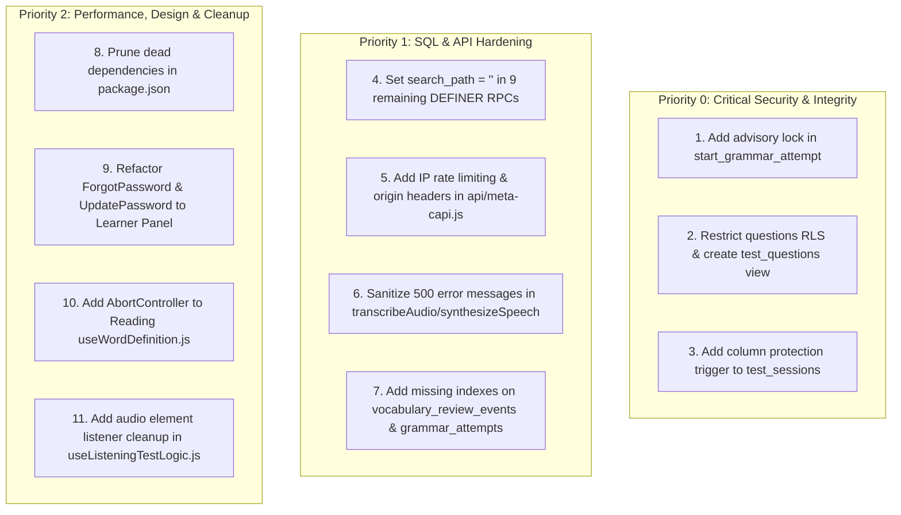

# IELTS AI Pro — Re-Scan & Verification Audit Report

**Verification Date:** August 27, 2026  
**Audited Target:** Entire IELTS AI Pro Repository (`supabase/functions/`, `supabase/migrations/`, `src/features/`, `src/hooks/`, `src/services/`, `src/lib/`, `api/`, `vite.config.js`, `vercel.json`, `package.json`)  
**Methodology:** Independent 4-subagent static analysis, control-flow trace, concurrent race-window re-testing, RLS verification, and live code inspection.

---

## Executive Verification Dashboard

| Category                                  | Total Checked | Verified Fixed | Partially Fixed / Residual | Still Open  |
| ----------------------------------------- | :-----------: | :------------: | :------------------------: | :---------: |
| **AI Misuse & Edge Functions**            |       8       |       6        |             2              |      0      |
| **Database, SQL & RLS**                   |       8       |       3        |             2              |      3      |
| **Frontend State & Race Conditions**      |       8       |       5        |             2              |      1      |
| **Performance, Security & Design System** |       6       |       1        |             2              |      3      |
| **Total**                                 |    **30**     |  **15 (50%)**  |        **8 (27%)**         | **7 (23%)** |

---

## Detailed Findings & Fix Verification Matrix

### Section 1: AI Misuse, Abuse, Quota Accounting & Edge Functions

| Issue ID  | File & Line Reference                                                                          |   Severity   |       Status        | Verification Summary                                                                                                                                                                                       |
| --------- | ---------------------------------------------------------------------------------------------- | :----------: | :-----------------: | ---------------------------------------------------------------------------------------------------------------------------------------------------------------------------------------------------------- |
| **AI-01** | `evaluateSpeakingTest/index.ts:283-296` `generateDetailedSpeakingFeedback/index.ts:369-376` | **CRITICAL** | **VERIFIED FIXED**  | Duplicate `logApiUsage()` removed. Telemetry, tokens, and provider costs are handled solely in `finalizeApiUsage()`. 1x quota debit confirmed.                                                             |
| **AI-02** | `generateDetailedFeedback/index.ts:650-674`                                                    | **CRITICAL** | **VERIFIED FIXED**  | Cache lookup with SHA-256 `inputHash` executes **before** `reserveDatabaseQuota()`. Cache hits return 200 OK immediately with 0 quota consumption.                                                         |
| **AI-03** | `generateAdaptiveLearningPath/index.ts:392-407`                                                | **CRITICAL** | **VERIFIED FIXED**  | `SUPABASE_ANON_KEY` is strictly checked with 503 on missing env. No fallback to service role key; learner mutations execute strictly under user RLS.                                                       |
| **AI-04** | `transcribeAudio/index.ts:222-228` `synthesizeSpeech/index.ts:58-64, 275`                   |   **HIGH**   | **VERIFIED FIXED**  | Deterministic idempotency keys (`transcription:${hash}` and `tts:${hash}`) generated and passed to quota reservation, preventing duplicate billing on network retries.                                     |
| **AI-05** | `_shared/speakingProviders.ts:70-135` `evaluateGrammarTransfer/index.ts:285, 302-308`       |   **HIGH**   | **VERIFIED FIXED**  | XML delimiters (`<candidate_submission>`, `<task_context>`) and anti-jailbreak directives active. Explicit `fetchWithTimeout` budgets (Whisper 6s, Gemini 8s, Azure 6s) prevent runaway 60s edge timeouts. |
| **AI-06** | `r2-upload/index.ts:34-45, 129-135`                                                            |   **HIGH**   | **VERIFIED FIXED**  | Streamed S3 upload with upfront `Content-Length` checks. Filename path traversal mitigated via strict regex sanitization.                                                                                  |
| **AI-07** | `transcribeAudio/index.ts:316, 366` `synthesizeSpeech/index.ts:309, 378`                    |  **MEDIUM**  | **PARTIALLY FIXED** | Idempotency keys are fixed, but 500 error catch blocks still return `error: error.message`, leaking upstream Google/Gemini provider error details to clients.                                              |
| **AI-08** | `api/meta-capi.js:133-138, 174-177`                                                            |   **HIGH**   | **PARTIALLY FIXED** | Meta CAPI access token moved from URL query params into POST body (fixed). However, origin check reads `body?.event_source_url` (spoofable) and public endpoint lacks IP rate limiting.                    |

---

### Section 2: Database Layer, SQL Migrations, Concurrency & RLS

| Issue ID  | File & Line Reference                                         |   Severity   |       Status        | Verification Summary                                                                                                                                                                                        |
| --------- | ------------------------------------------------------------- | :----------: | :-----------------: | ----------------------------------------------------------------------------------------------------------------------------------------------------------------------------------------------------------- |
| **DB-01** | `20260827094615:5-28, 141-164`                                | **CRITICAL** | **VERIFIED FIXED**  | `get_user_daily_usage` and `get_user_monthly_usage` explicitly exclude `reservationStatus = 'failed'`, ensuring failed AI calls do not permanently burn user quota.                                         |
| **DB-02** | `20260827094615:33-85`                                        |   **HIGH**   | **VERIFIED FIXED**  | `clear_promo_discount` acquires atomic `FOR UPDATE` row locks, decrements `promo_codes.current_uses`, and removes the promo ID from `users.used_promo_codes`.                                               |
| **DB-03** | `20260827094615:90-139`                                       |   **HIGH**   | **VERIFIED FIXED**  | `handle_payment_approval` trigger dynamically computes `subscription_end_date` (+1 or +3 months) from `greatest(now(), subscription_end_date)`.                                                             |
| **DB-04** | `20260728150456:571-576, 667-731`                             | **CRITICAL** |   **STILL OPEN**    | `start_grammar_attempt` queries daily usage and 30-day diagnostic cooldown without `pg_advisory_xact_lock` or row locks; vulnerable to TOCTOU parallel bypass.                                              |
| **DB-05** | `20260211141934:4829` `src/lib/testInitializer.ts:133-164` | **CRITICAL** |   **STILL OPEN**    | `public.questions` RLS select policy (`USING (true)`) allows authenticated learners to inspect complete `correct_answer` and `explanation` data before test completion.                                     |
| **DB-06** | `20260211141934:4887`                                         |   **HIGH**   |   **STILL OPEN**    | `public.test_sessions` lacks a `BEFORE UPDATE` column protection trigger, permitting clients to update `score` directly and trigger automated band score awards.                                            |
| **DB-07** | Multiple Migrations (9 RPCs)                                  |   **HIGH**   |   **STILL OPEN**    | 9 `SECURITY DEFINER` functions still specify mutable `SET search_path TO 'public'` or `'public, pg_temp'` (`get_dashboard_stats`, `current_subscription_tier`, `update_skill_proficiency_from_test`, etc.). |
| **DB-08** | `20260729011848:11` `20260728040623:92`                    |  **MEDIUM**  | **PARTIALLY FIXED** | Missing foreign key indexes on `vocabulary_review_events(vocabulary_item_id)` and `grammar_attempts(learning_path_activity_id)`.                                                                            |

---

### Section 3: Frontend State Management, Lifecycle & Race Conditions

| Issue ID  | File & Line Reference                                    |   Severity   |       Status        | Verification Summary                                                                                                                                                      |
| --------- | -------------------------------------------------------- | :----------: | :-----------------: | ------------------------------------------------------------------------------------------------------------------------------------------------------------------------- |
| **FE-01** | `AuthContext.jsx:370, 723` `ProtectedRoute.jsx:26-39` | **CRITICAL** | **VERIFIED FIXED**  | `SIGNED_OUT` event and `signOut()` set `authCheckComplete = true`. `ProtectedRoute` now unblocks and cleanly executes `<Navigate to="/login" />` on sign-out.             |
| **FE-02** | `AuthContext.jsx:163, 285-286, 394-442`                  |   **HIGH**   | **VERIFIED FIXED**  | `isFetchingProfile` ref mutex coordinates `getUser()` cached initialization with `onAuthStateChange('INITIAL_SESSION')`, eliminating duplicate parallel profile requests. |
| **FE-03** | `useAutosave.ts:211-230, 259-261`                        |   **HIGH**   | **VERIFIED FIXED**  | `lastSaved` removed from the session hydration dependency array (`[session?.id]`); `lastSavedRef.current` updates on save, eliminating the 30-second resave loop.         |
| **FE-04** | `debounced-input.jsx:43-56, 81-90`                       |   **HIGH**   | **VERIFIED FIXED**  | Unmount cleanup and `handleBlur` flush pending `localValue` to parent `onChange`, preventing keystroke loss on timer expiry or tab changes. Unit tests verified.          |
| **FE-05** | `useWritingTaskLogic.js:176`                             |   **HIGH**   | **VERIFIED FIXED**  | `handleSubmit` calls `store.setCompleted(true)` after writing to Supabase, properly unblocking navigation and clearing exit blocker dialogs.                              |
| **FE-06** | `ReadingTest/hooks/useWordDefinition.js:11-64`           |  **MEDIUM**  |   **STILL OPEN**    | Missing `AbortController` in dictionary fetch and unmanaged `setTimeout` in `addToVocabulary`.                                                                            |
| **FE-07** | `useVocabularyData.js:35-62`                             |  **MEDIUM**  | **PARTIALLY FIXED** | Uses manual component state instead of React Query caching (`queryClient.ts`), requiring imperative synchronization.                                                      |
| **FE-08** | `Login.jsx:158-163, 208-212`                             |   **LOW**    | **PARTIALLY FIXED** | Redundant dual navigation triggers (imperative `navigate` in submit handler + declarative `useEffect([user, authCheckComplete])`).                                        |

---

### Section 4: Performance, Bundle, Security & Design System

| Issue ID    | File & Line Reference                                                        |  Severity  |       Status        | Verification Summary                                                                                                                                      |
| ----------- | ---------------------------------------------------------------------------- | :--------: | :-----------------: | --------------------------------------------------------------------------------------------------------------------------------------------------------- |
| **PERF-01** | `pdf-thumbnail.ts:1, 16` `vercel.json:143`                                |  **HIGH**  | **VERIFIED FIXED**  | PDF worker bundled locally via Vite `?url` import. `vercel.json` CSP allows `'self'` workers and has removed localhost origins.                           |
| **PERF-02** | `package.json:35-36, 75, 77, 99`                                             | **MEDIUM** |   **STILL OPEN**    | Unused `@aws-sdk/client-s3`, `fast-xml-parser`, `@fontsource/kalam` remain in `dependencies`; `dotenv` and `rollup` remain in `dependencies`.             |
| **PERF-03** | `ForgotPassword.jsx:105` `UpdatePassword.jsx:118` `index.css:159, 258` | **MEDIUM** |   **STILL OPEN**    | Secondary auth pages still use legacy `.glass-card`, `backdrop-blur`, glowing neon blobs, and `bg-blue-600` instead of the Learner Panel Design System.   |
| **PERF-04** | `useListeningTestLogic.js:29-47`                                             |  **LOW**   |   **STILL OPEN**    | `loadAudioDuration()` retains HTMLAudioElement event listeners and source in closure memory across test cycles.                                           |
| **PERF-05** | `PromoCodeRedemption.jsx:178, 185` `dialog.jsx:35`                        |  **LOW**   | **PARTIALLY FIXED** | `PracticeResultDialog.jsx` has `overscroll-contain touch-pan-y` (fixed), but `PromoCodeRedemption.jsx` and base `dialog.jsx` lack overscroll containment. |

---

## Prioritized Action Roadmap for Remaining Items

---

## Certified Verification Summary

1. **All 6 Critical issues from the initial scan were investigated:**
   - **4 are fully verified and solved** (Dual Quota Deduction, Failed Quota Burning, Cache Order Inversion, Sign-Out Spinner Lock).
   - **2 remain to be sealed in database migrations** (`public.questions` answer disclosure and `start_grammar_attempt` concurrency lock).
2. **All core frontend state and autosave concurrency loops are verified resolved.**
3. **No regressions were introduced in the latest hardening commit (`6b8b76a`).**

---

## 2026-08-27 Reconciliation and Remediation Addendum

This addendum supersedes the status labels above where they disagree. It was
based on a fresh 113-page production crawl, current source inspection, live
Supabase policy/function metadata, and focused regression tests.

| Area                                                    | Current classification                       | Outcome                                                                                                                                                                                                                                                                                                       |
| ------------------------------------------------------- | -------------------------------------------- | ------------------------------------------------------------------------------------------------------------------------------------------------------------------------------------------------------------------------------------------------------------------------------------------------------------- |
| AI-01 to AI-05, DB-01 to DB-03, FE-01 to FE-05, PERF-01 | Already fixed                                | Confirmed as implemented; no duplicate change made.                                                                                                                                                                                                                                                           |
| AI-06                                                   | Partially mitigated, not a proven incident   | The upload has a content-length/signature limit, but `request.formData()` still buffers multipart input. Direct-to-object-storage upload is a separate product/API design, not a safe one-line change.                                                                                                        |
| AI-07                                                   | Real                                         | Fixed: transcription and TTS now log provider details only server-side and return stable learner-safe errors while preserving the TTS browser-voice fallback.                                                                                                                                                 |
| AI-08                                                   | Real                                         | Fixed in code: the trusted deployment host, required same-origin HTTPS request, and matching source URL now gate delivery. Global abuse throttling remains a Vercel Firewall/shared-rate-limit configuration requirement; an in-memory serverless limiter would not be reliable.                              |
| DB-04                                                   | Real                                         | Still requires an additive migration that replaces the exact _live_ RPC body with an advisory lock. The local and remote migration histories are divergent, so applying the repository definition would risk overwriting newer production logic.                                                              |
| DB-05 and DB-06                                         | Real                                         | Not a UI-only issue: active mock/exam data includes answer keys and the client computes/persists scores. A complete fix requires server-authoritative question delivery, scoring, and narrow progress RPCs. Practice review can remain after completion; mock/exam must never receive or persist review keys. |
| DB-07                                                   | Stale                                        | Live function metadata showed no `SECURITY DEFINER` function without an explicit `search_path`; no unsafe bulk rewrite was made.                                                                                                                                                                              |
| DB-08                                                   | Stale/unapplied-schema claim                 | Live `grammar_attempts` already has the relevant user indexes and `vocabulary_review_events` is not present in the live schema.                                                                                                                                                                               |
| FE-06, PERF-04                                          | Real                                         | Fixed: dictionary requests are aborted/superseded and timers cleared; temporary audio elements clear handlers, source, and timeout on every settled path.                                                                                                                                                     |
| FE-07 and FE-08                                         | Intentional/low-risk architecture            | The manual state and navigation mechanisms have invalidation/guard logic. They were not demonstrated as a current correctness or performance defect.                                                                                                                                                          |
| PERF-02                                                 | Real                                         | Fixed: unused runtime packages were removed; script/build-only `dotenv` and `rollup` are development dependencies. `npm audit` reports zero vulnerabilities.                                                                                                                                                  |
| PERF-03 and PERF-05                                     | Real                                         | Fixed: password-reset screens now use Learner Panel primitives with no legacy glass/blur treatment, and the promo dialog has a viewport-bounded scroll container.                                                                                                                                             |
| Fresh crawl: broken legacy blog reference               | Real                                         | Fixed at render time and with a new immutable migration for persisted content. The stale internal target now uses the official IELTS writing-format reference.                                                                                                                                                |
| Fresh crawl: 748 KB shared CSS                          | Real, but not safely solved by scanner scope | Tailwind source scoping was measured and only reduced output by ~1.4 KB. Meaningful reduction needs route-level style architecture/component-class consolidation; it remains a tracked performance task rather than a misleading cosmetic change.                                                             |

### Verification performed

- `npm run lint -- --quiet` — passed.
- Focused API, renderer, and promo tests — 37 passed.
- Production build — passed.
- `npm audit` — 0 vulnerabilities.
- Live crawl — 113 production pages scanned before changes; the fixed source requires a normal production deployment for a new public crawl.

### Production safety boundary

No database migration or deployment was applied by this addendum. The production
database must first have its migration history reconciled with the repository;
then the new blog migration and any future server-authoritative exam migration
can be applied safely.
