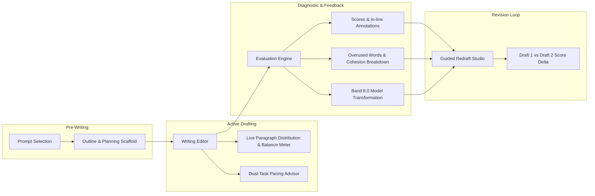

# Implementation Plan: IELTS Academic Writing Test Enhancement

Transform the IELTS Writing test section from an evaluation tool into an end-to-end **Writing Mastery & Coaching System**. This plan introduces structured pre-writing planning, real-time paragraph balance & pacing, Band 8.0 essay transformations, overused words analysis, and a guided "Rewrite & Rescore" iteration cycle.

_(Note: Official CD-IELTS Exam Mode replica and General Training Task 1 support are excluded per user preference)._

---

## 1. Architectural Overview & Workflow

---

## 2. Core Feature Specifications

### Feature 1: Pre-Writing Planning & Outline Scaffold (Planning Studio)

- **Problem Solved**: Candidates often rush into drafting without planning, leading to incoherent paragraph structure, missing overviews in Task 1, and underdeveloped arguments in Task 2.
- **Components**:
  - `OutlineScaffoldDrawer.jsx` (New component):
    - **Task 2**: Identifies question type (_Agree/Disagree, Discuss Both Views, Problem/Solution, Advantages/Disadvantages, Double Question_) and generates a 4-paragraph scaffolding form:
      1. **Introduction**: Prompt paraphrase + Thesis statement.
      2. **Body 1**: Topic sentence + Explanation + Supporting example.
      3. **Body 2**: Second view / Counterpoint + Development.
      4. **Conclusion**: Restatement of thesis + Summary of key ideas.
    - Button: _"Insert Outline as Template into Editor"_ (adds structured comments/headings to start writing).
    - **Task 1**: Dedicated **Overview Formulation Assistant** prompting candidates to state the 1–2 main trends/extremes without numbers (Band 6+ requirement).
  - Integrated into `WritingEditor.jsx` via an "Outline & Plan" drawer toggle.

---

### Feature 2: Live Paragraph Word-Distribution & Balance Meter

- **Problem Solved**: Students write unbalanced essays (e.g. 160 words in Body 1, 30 words in Body 2), leading to Task Response penalties.
- **Components**:
  - Live paragraph parser integrated into `WritingEditor.jsx`.
  - Micro segmented progress bar in editor footer:
    `Intro: 42w | Body 1: 96w | Body 2: 92w | Conclusion: 38w`
  - Real-time warnings:
    - _Underdeveloped Body Paragraph Warning_ (e.g. Body 2 is <60% length of Body 1).
    - _Overextended Introduction Warning_ (Intro > 65 words).
    - _Missing Paragraph Breaks Warning_ (Essay > 150 words with no paragraph breaks).

---

### Feature 3: Dual-Task Time Allocation Advisor (Cambridge 60-min Mock)

- **Problem Solved**: 35% of candidates spend >28 minutes on Task 1 and fail to complete Task 2 (which is worth double the marks).
- **Components**:
  - In `WritingTestClock.jsx` / `WritingHeader.jsx`:
  - When practicing in combined Task 1 + Task 2 mode, trigger a gentle notification at 20:00 elapsed:
    _"Recommended: Switch to Task 2 now (Task 2 contributes 67% of your overall writing score)."_
  - Dual time-elapsed indicators: `Task 1: 18m | Task 2: 24m`.

---

### Feature 4: Band 8.0 AI Model Transformation (Side-by-Side Essay Upgrader)

- **Problem Solved**: Current feedback shows what is wrong, but does not show students how _their own ideas_ look when written at Band 8.0+.
- **Components**:
  - Backend schema update in `generateDetailedFeedback/index.ts`:
    - Generates `band8Rewrite`: An elevated version of the candidate's exact essay, preserving their logic and points while upgrading vocabulary to natural academic collocations and sentences to complex grammatical structures.
  - `BandUpgradeView.jsx` (New component):
    - Side-by-side or split diff comparison view in `FeedbackPanel.jsx`.
    - Highlights elevated vocabulary and complex structures with interactive chips explaining why each change improves the band score.

---

### Feature 5: Overused Words & Cohesive Variety Analyzer

- **Problem Solved**: Candidates repeat words like "important", "people", "increase" and rely on formulaic linkers ("Firstly, Secondly, In conclusion").
- **Components**:
  - Heatmap chip cloud of words repeated $\ge 4$ times in the essay with 2–3 contextual C1/C2 collocations.
  - Cohesive device classification: Mechanical linkers (_Firstly, Moreover, In addition_) vs. Natural referential linkers (_This phenomenon, Such measures, Consequently_).

---

### Feature 6: Guided "Draft 2: Redraft Studio" & Score Delta

- **Problem Solved**: The single most effective way to improve writing is redrafting, but students usually read feedback and leave without revising.
- **Components**:
  - `RedraftStudio.jsx` (New component):
    - Left pane: Draft 1 with active annotations and priority issues.
    - Right pane: Draft 2 workspace with pre-populated text and a live checklist of resolved issues.
  - Resubmission evaluation showing a **Band Score Delta Card**:
    $$\text{Draft 1: Band 6.0} \longrightarrow \mathbf{\text{Draft 2: Band 7.0}} \ (+1.0)$$
    Highlighting exact criterion improvements (`Lexical Resource: 6.0 → 7.0`, `Grammar: 6.0 → 6.5`).
  - Zustand store extension in `useWritingTestStore.js` to manage multi-version drafts and score comparisons.

---

### Feature 7: Interactive "Ask Examiner AI" Consultation Drawer

- **Problem Solved**: Students often have questions about specific feedback or scores.
- **Components**:
  - Button on each priority card and annotation in `FeedbackPanel.jsx`: _"Ask Examiner AI"_.
  - Opens a lightweight contextual chat drawer allowing students to ask:
    _"Why did I get 6.0 in Task Response here?"_ or _"Give me 3 alternative ways to express this sentence."_

---

## 3. UI/UX Design System Compliance

All components follow the **Learner Panel Design System**:

- Primitives: `PANEL`, `WELL`, `TILE`, `NUM`, `MICRO`, `TITLE`, `Pill`, `IconChip`, `Bar`.
- Hairline borders (`border-[#e4e2f0]` / `dark:border-white/[0.07]`), subtle card elevation gradients, zero heavy drop shadows.
- Monospace numbers for word counts, timer, and scores (`NUM`).
- Signal colors: `--signal-ok` (success), `--signal-warn` (borderline/warning), `--signal-fault` (error), and brand accent `#5a63df`.

---

## 4. Verification & Testing Strategy

1. **Automated Unit & Integration Tests**:
   - `src/__tests__/features/writing-outline-scaffold.test.jsx`: Template generation and insertion.
   - `src/__tests__/features/writing-paragraph-distribution.test.jsx`: Paragraph word counter and balance alerts.
   - `src/__tests__/features/writing-redraft-delta.test.jsx`: Draft 1 vs Draft 2 state and delta calculation.
   - `src/__tests__/lib/writingProvider.test.ts`: AI feedback schema tests.
2. **Quality Gates**:
   - Full test suite: `npm run test:unit`
   - Linter pass: `npm run lint`
   - Build verification: `npm run build`
